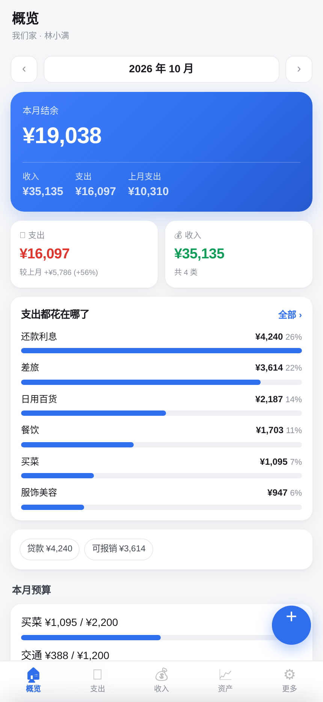
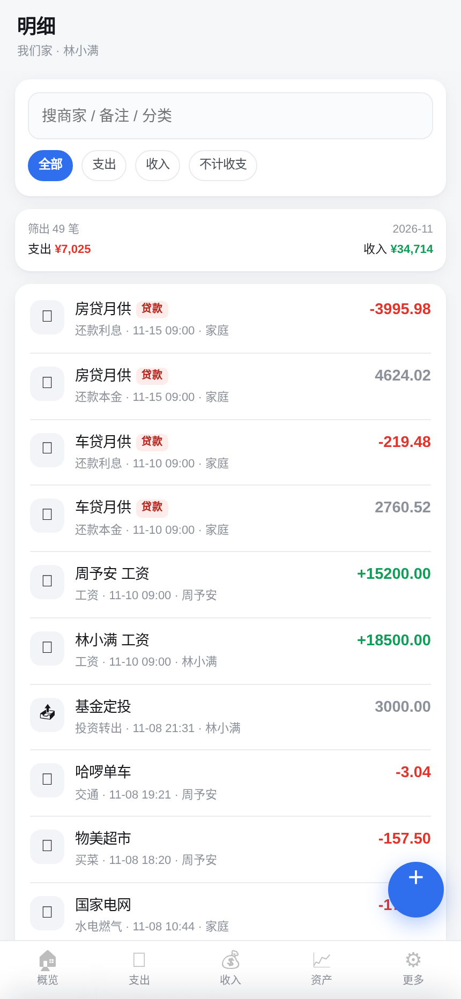
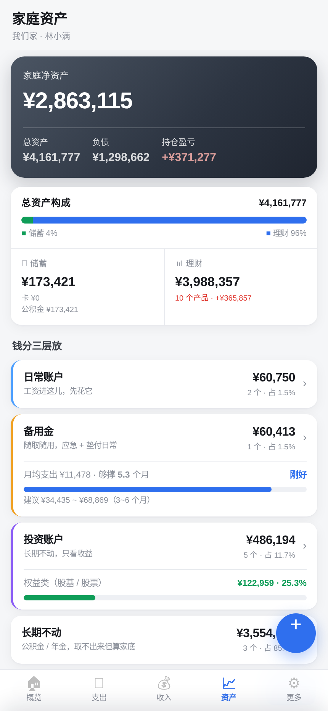
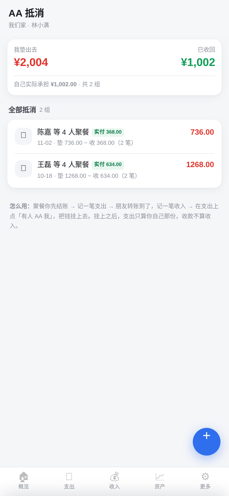
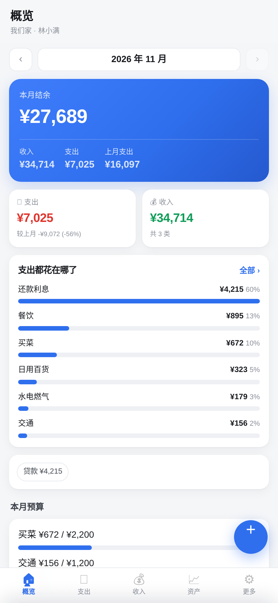

# Family Ledger · 家庭记账

> 一个可自托管的家庭记账系统。两个人在同一个账本上记账，账算得清，数据在自己机器上。

<!-- 首图：桌面端首页，横向 16:9，放在 docs/screenshots/01-home.png -->


<p align="center">
  
  
  
  
</p>

---

## ⚠️ 先看这三条，能省掉 80% 的麻烦

这套系统跑在**你自己的 Linux 服务器**上，不是网页版、不是 App、不用注册账号。装之前请确认：

| # | 硬性前提 | 为什么 |
|---|---|---|
| 1 | 一台**干净的** Linux 服务器（Ubuntu 22.04/24.04、Debian 12/13、Rocky/Alma 9），2 核 2G 起 | **已经装了宝塔 / nginx / apache 的机器装不了**——80、443 端口被占用，HTTPS 起不来。这是最高频的失败原因 |
| 2 | **一个已解析到这台服务器的域名** | 系统用 Caddy 自动申请 HTTPS 证书。没有域名就只有自签证书，浏览器会报警告，手机端也不好用 |
| 3 | 能访问镜像仓库（Docker Hub 或配置了镜像加速） | 国内服务器直连 Docker Hub 常常超时，需要先在 `/etc/docker/daemon.json` 配 `registry-mirrors` |

### 装之前，先跑一次自检

仓库里带了一个只读脚本，会把这台机器上「会卡住你」的问题提前找出来——**这不花钱，也不用先买东西**：

```bash
curl -fsSL https://raw.githubusercontent.com/SherlockT94/family-ledger/main/scripts/check.sh -o check.sh
bash check.sh 你的域名.com
```

它会检查系统版本、内存磁盘、Docker 与 Compose 版本、80/443 端口占用、宝塔与 nginx 冲突、镜像仓库连通性、Let's Encrypt 可达性、系统时间偏差、域名解析是否指向本机、防火墙与安全组、SELinux 状态，最后给一个通过/警告/失败的汇总。

> 全部 `[ OK ]` 才动手买部署包。有 `[FAIL]` 就先解决，解决不了就先别买——这是这套东西唯一诚实的地方。

完整前提清单与逐条处理办法见 **[docs/prerequisites.md](docs/prerequisites.md)**。

---

## 为什么会有这个项目

市面上记账 App 不缺，缺的是「**两个人一起用，还能对得上**」。

我们试过的方案都有同一个问题：账单导不进来，或者导进来之后重复记账。原因很简单——家庭里的钱是**交叉**的：

- 微信账单里有一笔「给老婆的转账」，她的账单里同一时刻有一笔「收到老公转账」
- 亲情卡消费，主卡和副卡各记一次
- 一起吃饭我先付了，月底该她给我一半
- 出差花了公司的钱，但账先从我家这边出

这些问题，单人记账软件不处理，因为它们假设「钱只有一个人在花」。

所以我自己写了。跑了大半年，现在把它整理出来，给同样被这个问题困住的人。

## 它具体做什么

### 账单进来就对得上

| 能力 | 说明 |
|---|---|
| 微信 / 支付宝账单导入 | 支持官方导出的 CSV，批量导入，自动识别字段格式 |
| **双侧合并去重** | 夫妻双方各自导出账单后合并，同一笔消费只保留一条——靠交易时间 + 金额 + 对手方生成指纹 |
| 亲情卡 / 副卡识别 | 同一笔消费在主副卡两侧的重复记录，标记为单笔 |
| 转账配对 | 内部转账（我→你、你→我）自动识别，不重复计入家庭收支 |

### 钱怎么算清

- **AA 抵消**：谁付了多少、谁欠谁多少，系统直接给一个净额，不用手工列表
- **差旅报销**：支出按笔挂靠到某个报销单，报销回款单独归集，不计入家庭消费
- **理财结转**：账户之间的转入转出不混进支出统计

### 账本本身

- 家庭为单位的多用户账本，邀请码加入，各家庭数据互相隔离
- 100+ 条内置分类规则，商户名匹配即自动分类，可增删
- 月度 / 年度收支报表，分类占比与趋势
- 数据存在自己的服务器上（SQLite 单文件，备份就是拷一个文件）

## 技术栈

```
前端   单页应用（原生 JS，无构建步骤）
后端   Python 3.11 · FastAPI
存储   SQLite（单文件，启用 WAL）
部署   Docker Compose + Caddy（自动 HTTPS）
```

选型原则是**一个人能维护**：没有 Redis、没有消息队列、没有需要独立部署的数据库。一台 2C2G 的机器足够跑一个家庭，备份就是把 `data/` 目录拷走。

## 为什么不支持这些

| 环境 | 结论 |
|---|---|
| Windows / WSL | 不支持。文件权限与端口映射差异太大，出问题无法远程排查 |
| 群晖 / 威联通 NAS 的 Docker | 未测试。理论上能起，但路径与权限需要自己处理，不提供支持 |
| 虚拟主机 / 共享空间 | 不支持。没有 root、不能跑容器 |
| 已装宝塔的服务器 | 不支持。端口冲突，且两套 Web 服务的规则会互相覆盖 |
| 纯 IP 访问（无域名） | 不支持。HTTPS 签不出来，手机端会被拦 |

## 状态

- 自用中，数据完整，日常在跑
- 正在做：对外部署加固（密码策略、登录限流、找回密码、数据导出与注销）
- 部署包（镜像 + 一键脚本 + 图文手册）整理中。**想第一时间拿到，点 Watch → Custom Releases only**

## License

本仓库内容（文档与截图）仅作项目介绍用途，**不含核心源码**。
可部署版本以发行包形式提供，含单域名授权，详见发行包内 `LICENSE`。

---

<sub>如果你也在为「两个人怎么把钱算清」头疼，欢迎在 Issues 里说说你的场景——我很想知道别人的家庭是怎么处理这些事的。</sub>
